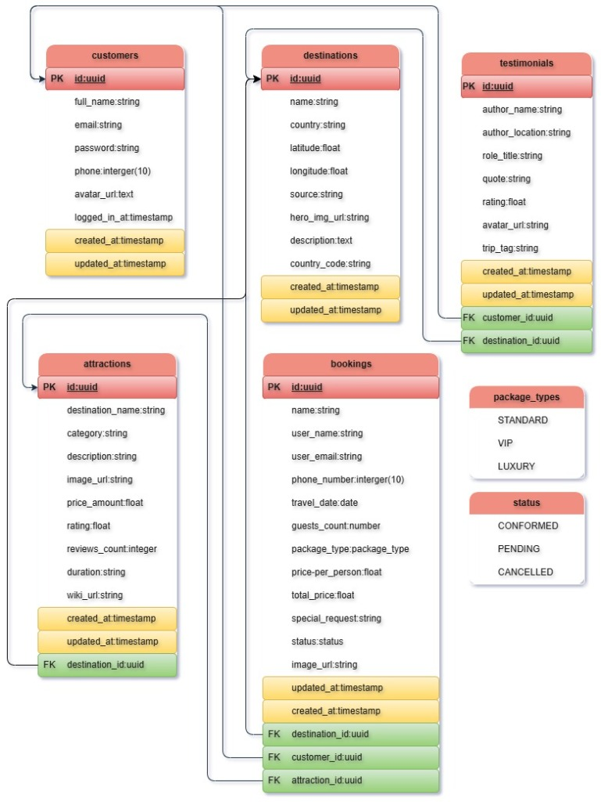
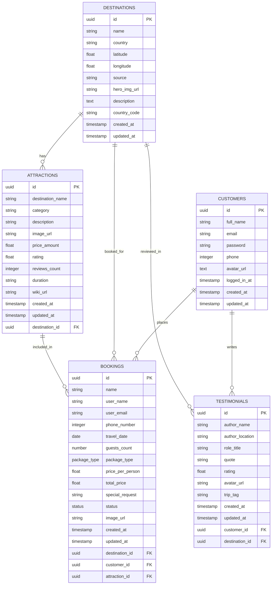

# ✈️ Jadoo - Travel Agency & Booking Platform

[](https://nodejs.org/)
[](https://www.typescriptlang.org/)
[](https://www.postgresql.org/)
[](https://expressjs.com/)
[](https://leafletjs.com/)
[](LICENSE)

A modern, responsive, full-featured travel agency and booking platform built with **HTML5**, **CSS3**, **TypeScript**, and **Vanilla JavaScript**, backed by an **Express REST API** and a hosted **PostgreSQL** database on Render.

Features an interactive Leaflet map with OpenStreetMap tiles, live attraction geocoding via Wikipedia, instant client-side QR-coded Boarding Passes with PDF download, a personal traveler dashboard, complete dual theme support (Light & Dark), and mobile-first drawer navigation.

---

## 📑 Table of Contents
- [🌟 Key Features](#-key-features)
- [🗄️ Database Architecture & ER Diagram](#️-database-architecture--er-diagram)
- [📁 Project Structure](#-project-structure)
- [🛠️ Tech Stack & Libraries](#️-tech-stack--libraries)
- [🚀 Getting Started](#-getting-started)
  - [Prerequisites](#prerequisites)
  - [Environment Configuration](#environment-configuration)
  - [Database Migration & Seeding](#database-migration--seeding)
  - [Building & Running Locally](#building--running-locally)
- [🌐 REST API Endpoints](#-rest-api-endpoints)
- [☁️ Deployment (Render)](#️-deployment-render)
- [📄 License](#-license)

---

## 🌟 Key Features

### 1. Interactive Leaflet Map & Category Explorer (`components/destination-page.html`)
* **Leaflet.js & OpenStreetMap**: Interactive map initialized with custom vector map pins, location popups, and smooth bound adjustments based on attraction coordinates.
* **Live Geosearch & Landmark Resolution**: Automatically resolves coordinates and nearby attractions via Wikipedia Geosearch API and an offline database of 150,000+ world cities (`cities.json`).
* **Multi-View Switcher**: Toggle seamlessly between **Grid View**, **Interactive Map View**, and **Split Screen View**.
* **Filter System**: Filter destinations by categories (*Landmarks*, *Museums & Art*, *Architecture*, *Nature & Scenery*, *Entertainment & Leisure*), price ranges, and star ratings.

### 2. Heritage Boarding Pass & E-Ticket Generator (`components/ticket.html`)
* **Responsive E-Ticket Layout**: Styled voucher ticket with booking reference, passenger information, flight route, itinerary details, and security barcodes.
* **Unminified Client-Side QR Code Engine**: Generates real, scannable SVG/Canvas QR codes offline using [`scripts/qrcode.js`](./scripts/qrcode.js) with CDN fallback.
* **Instant PDF Download**: One-click **"Download PDF Pass"** powered by `html2pdf.js` with print-specific layout optimizations (`@media print`).

### 3. Traveler Profile & Account Dashboard (`components/profile.html`)
* **Live Statistics**: Real-time summary cards tracking Total Trips Booked, Active Journeys, and Total Amount Spent.
* **Booking History Tabs**: Filter bookings across **All**, **Confirmed** (emerald badge), **Pending** (amber badge), and **Cancelled** (rose badge).
* **Profile Management**: Update full name, phone number, and avatar with instant synchronization across navigation bars.

### 4. Comprehensive Theme System (Light & Dark Modes)
* **Smooth Color Transitions**: Custom CSS variables for both themes with contrast ratios meeting WCAG 2.1 AA standards.
* **Persistent Preferences**: Auto-detects system color scheme (`prefers-color-scheme`) and persists user toggle in `localStorage`.
* **Zero Layout Shift**: Fluid typography and spacing using `clamp()` with rem/vw units.

### 5. Services Catalogue & Support (`components/services.html` & `components/contact.html`)
* **Curated Travel Services**: Full catalog for *Calculated Weather*, *Best Flights & Aviation*, *Local Cultural Events*, and *Bespoke Customization*.
* **Customer Care Center**: Interactive contact form, 24/7 emergency support line, FAQ accordion, and interactive office locations.

### 6. Authentication & Form Validation (`components/auth.html`)
* **Client & Server Auth**: Secure sign-up and login with password strength meter, email format check, and hashed credential verification via `bcryptjs`.
* **Deep Linking**: Direct navigation support for `#signin` and `#signup` hash anchors.

---

## 🗄️ Database Architecture & ER Diagram

The platform utilizes a relational PostgreSQL database schema with foreign-key referential integrity, UUID primary keys, and custom enum types.

### Visual ER Diagram



### Entity-Relationship Schema (Mermaid)



### Database Tables & Fields

| Table | Primary Key | Foreign Keys | Key Attributes |
|---|---|---|---|
| **`customers`** | `id: uuid` | — | `full_name`, `email` (UNIQUE), `password`, `phone`, `avatar_url`, `logged_in_at`, `created_at`, `updated_at` |
| **`destinations`** | `id: uuid` | — | `name` (UNIQUE), `country`, `latitude`, `longitude`, `source`, `hero_img_url`, `description`, `country_code`, timestamps |
| **`attractions`** | `id: uuid` | `destination_id` &rarr; `destinations(id)` | `destination_name`, `category`, `description`, `image_url`, `price_amount`, `rating`, `reviews_count`, `duration`, `wiki_url`, timestamps |
| **`bookings`** | `id: uuid` | `destination_id`, `customer_id`, `attraction_id` | `name`, `user_name`, `user_email`, `phone_number`, `travel_date`, `guests_count`, `package_type` (`STANDARD` \| `VIP` \| `LUXURY`), `price_per_person`, `total_price`, `special_request`, `status` (`CONFORMED` \| `PENDING` \| `CANCELLED`), `image_url`, timestamps |
| **`testimonials`** | `id: uuid` | `customer_id`, `destination_id` | `author_name`, `author_location`, `role_title`, `quote`, `rating`, `avatar_url`, `trip_tag`, timestamps |

### Custom PostgreSQL Enums
* **`package_type`**: `'STANDARD'`, `'VIP'`, `'LUXURY'`
* **`booking_status`**: `'CONFORMED'`, `'PENDING'`, `'CANCELLED'`

---

## 📁 Project Structure

```
├── assets/                       # Images, branding icons, diagrams, and hero assets
│   ├── database-er-diagram.jpg   # Entity-Relationship diagram preview
│   ├── hero-section-background.png # Decorative top-right hero backdrop
│   └── ...
├── components/                   # Sub-pages and views
│   ├── auth.html                 # Sign-in & Sign-up authentication view
│   ├── contact.html              # Customer support & inquiry center
│   ├── destination-page.html     # Interactive Leaflet map & destination search
│   ├── profile.html              # Traveler account dashboard & booking history
│   ├── services.html             # Full services & packages catalogue
│   └── ticket.html               # Heritage E-Ticket & printable boarding pass
├── styles/                       # Modular CSS stylesheets
│   ├── styles.css                # Global styles, landing layout, header & navigation
│   ├── features.css              # Modals, tickets, maps, status badges, and toasts
│   ├── dark-theme.css            # Dark theme variables, tokens, and component overrides
│   ├── pages.css                 # Dedicated views for ticket, profile, contact, and services
│   ├── auth.css                  # Authentication card transitions and form styling
│   ├── tablet.css                # Tablet viewport media queries (<= 880px)
│   └── mobile.css                # Mobile viewport media queries (<= 650px)
├── scripts/                      # TypeScript source files & compiled JavaScript
│   ├── qrcode.js                 # Clean unminified client-side QR Code engine (614 lines)
│   ├── features.ts / js          # Ticket rendering, reviews, profile sync, and toast alerts
│   ├── destination.ts / js       # Leaflet map controller, search bar, and category filters
│   ├── auth.ts / js              # Client validation, password strength meter, auth handlers
│   ├── db.ts / js                # Client-side fallback database and storage sync
│   ├── script.ts / js            # Home carousel, drawer menu, theme toggler, smooth scroll
│   └── migrate.js                # Automatic PostgreSQL migration and seeding runner
├── services/                     # Backend services (Node.js / Express)
│   ├── db.ts / js                # PostgreSQL connection pool with SSL handling
│   ├── destinationService.ts / js# Wikipedia API integration & offline city geocoder
│   ├── serviceService.ts / js    # Service catalog data provider
│   └── fileService.ts / js       # Static asset handling
├── schema.sql                    # Production PostgreSQL DDL schema & seed records
├── server.ts / server.js         # Express HTTP server & REST API controller
├── tsconfig.json                 # TypeScript compiler configuration
└── package.json                  # Dependencies, build scripts, and metadata
```

---

## 🛠️ Tech Stack & Libraries

### Frontend
* **Core**: HTML5 (Semantic), CSS3 (Flexbox, CSS Grid, Custom Properties, fluid `clamp()`), TypeScript (Strict mode).
* **Interactive Maps**: [Leaflet.js](https://leafletjs.com/) v1.9.4 with [OpenStreetMap](https://www.openstreetmap.org/) tiles.
* **QR Codes**: [qrcode.js](./scripts/qrcode.js) client-side SVG/Canvas generator.
* **Document Export**: [html2pdf.js](https://ekoopmans.github.io/html2pdf.js/) for high-fidelity client-side PDF ticket downloads.
* **Icons & Typography**: Font Awesome 6, Google Fonts (*Poppins* & *Volkhov*).

### Backend & Database
* **Runtime**: Node.js (v24+ / ECMAScript Modules).
* **Framework**: [Express 5](https://expressjs.com/) with JSON middleware and CORS.
* **Database**: [PostgreSQL](https://www.postgresql.org/) hosted on Render.
* **Driver**: `pg` (node-postgres) with connection pooling and SSL encryption (`rejectUnauthorized: false`).
* **Geocoding Sources**: Wikipedia Open API (`https://en.wikipedia.org/w/api.php`) & `cities.json` dataset (150,000+ coordinates).
* **Security**: `bcryptjs` password hashing and parameterized SQL queries preventing SQL injection.

---

## 🚀 Getting Started

### Prerequisites
* **Node.js**: v20 or higher (v24 recommended).
* **PostgreSQL**: Accessible PostgreSQL instance (Local or Cloud such as Render, Neon, or Supabase).

### Environment Configuration
Create a `.env` file in the root directory (or configure environment variables in your deployment dashboard):

```env
# Application Port
PORT=3000

# PostgreSQL Connection String (Render / Cloud / Local)
DATABASE_URL=postgresql://jadoo_user:<password>@dpg-dbhi8f5g1s2s73a5ct8g-a.oregon-postgres.render.com/jadoo?sslmode=require

# Node Environment
NODE_ENV=development
```

### Database Migration & Seeding
To apply the table definitions and seed sample destinations, attractions, and customer accounts:

```bash
npm run migrate
```

### Building & Running Locally

1. **Install dependencies**:
   ```bash
   npm install
   ```

2. **Compile TypeScript**:
   ```bash
   npm run build
   ```

3. **Start the Express server**:
   ```bash
   npm start
   ```

4. **Open in browser**:
   Navigate to [http://localhost:3000](http://localhost:3000).

---

## 🌐 REST API Endpoints

| Method | Endpoint | Description |
|---|---|---|
| `GET` | `/api/health` | Healthcheck and PostgreSQL connection status |
| `GET` | `/api/destination?name=:query` | Live destination search with Wikipedia & local geocoding |
| `GET` | `/api/attractions` | List attractions with optional destination filter |
| `GET` | `/api/bookings` | List user bookings by email |
| `POST` | `/api/bookings` | Create new travel booking |
| `PATCH`| `/api/bookings/:id/status` | Update booking status (`CONFORMED`, `PENDING`, `CANCELLED`) |
| `GET` | `/api/testimonials` | Retrieve approved traveler testimonials |
| `POST` | `/api/testimonials` | Submit a new traveler testimonial |
| `POST` | `/api/auth/signup` | Register a new customer account |
| `POST` | `/api/auth/login` | Authenticate customer credentials |
| `GET` | `/api/services` | Retrieve curated travel service offerings |

---

## ☁️ Deployment (Render)

This repository is configured for one-click continuous deployment on **Render**:

1. **Service Type**: Web Service
2. **Environment**: Node
3. **Build Command**:
   ```bash
   npm install && npm run build
   ```
4. **Start Command**:
   ```bash
   node server.js
   ```
5. **Environment Variables**:
   Add `DATABASE_URL` pointing to your Render PostgreSQL database instance with `?sslmode=require`.

---

## 📄 License
This project is open-source and licensed under the [MIT License](LICENSE).
